<p align="center"></p>

<p align="center"></p>

<div align="center">

[![Build status][ci-badge]][ci-link] [![Go 1.26][go-badge]](go.mod) ![Installs on macOS][macos-badge] ![Engines pinned by version and checksum][pin-badge]

**[Install](#install)** · **[How it stops a leak](#what-stops-a-leak)** · **[Numbers](#numbers)** · **[Limits](#limits)**

</div>

**API Key Crawler** keeps your API keys off GitHub.\
It blocks a key when you commit, when you push and when an AI agent tries.\
Then it crawls your public repos every minute for any key that got through.

A key on a public repo is public.\
Deleting it later does not take it back.

The command is `keyguard`.

## A blocked commit

<p align="center"></p>

This commit holds a key learned from your Mac, so it is blocked.\
The same commit with `--no-verify` is blocked too.

<details>
<summary>The same output as text</summary>

```text
$ git commit -m "add billing config"
keyguard: commit blocked: 1 finding

  FILE            LINE  TYPE   SECRET         WHY
  src/billing.js     4  known  sk_live_…a1B2  your learned key STRIPE_SECRET_KEY (kg1a2b3c)

  fix: move the value to a gitignored .env and read it from the environment.
  do not bypass with --no-verify: real keys are also blocked at the
  ref level, and GitHub is re-scanned every minute.
  false positive? keyguard allow kg1a2b3c

$ git commit --no-verify -m "add billing config"
keyguard: ref update blocked: 1 finding

  COMMIT   FILE            LINE  TYPE   SECRET         WHY
  9752a3e  src/billing.js     4  known  sk_live_…a1B2  your learned key STRIPE_SECRET_KEY (kg1a2b3c)

  fix: move the value to a gitignored .env and read it from the environment.
  do not bypass with --no-verify: real keys are also blocked at the
  ref level, and GitHub is re-scanned every minute.
  false positive? keyguard allow kg1a2b3c
fatal: in 'prepared' phase, update aborted by the reference-transaction hook
```

The key and the commit id are made up for the picture.\
The wording is the program's own.

</details>

## What stops a leak

<p align="center"><picture>
<source media="(max-width: 600px)" srcset="docs/assets/layers-narrow.svg">

</picture></p>

| Layer | Watches | `--no-verify` |
|---|---|---|
| L1 `pre-commit` | `git commit`: keys in what you staged | skips it |
| L1 `commit-msg` | `git commit`: learned keys in the message | skips it |
| L1 `pre-push` | `git push`: keys in the commits that leave | skips it |
| L1 `reference-transaction` | a branch or tag moves: learned keys in new commits | no effect |
| L2 agent guard | an AI agent's commands, file writes and MCP calls | no effect |
| L3 GitHub scanning | GitHub's own scanning and push protection | no effect |
| L4 crawler | every minute: your public repos, wikis and gists | no effect |
| L5 publish check | before a repo goes public: its whole history | no effect |

A *learned key* is one that `keyguard learn` read from your Mac.\
Only its hash is kept.

How each layer works: [docs/HOW-IT-WORKS.md](docs/HOW-IT-WORKS.md).

## Install

You need macOS, Go 1.26, git 2.54 or newer, betterleaks, `jq`,\
and the `gh` CLI logged in to each account you watch.\
trufflehog (live checks) and gitleaks (a second pattern engine) are optional.

```sh
brew install betterleaks
go build -o bin/keyguard ./cmd/keyguard
bin/keyguard install
export PATH="$HOME/.keyguard/bin:$PATH"   # put this line in ~/.zshrc too
```

`install` puts in place:

- the binary at `~/.keyguard/bin/keyguard`, with its rules and config
- four git hooks in your global git config
- three launchd jobs: the crawl every minute, a deep scan on Sundays,\
  and an engine upgrade check on Saturdays

It is safe to run twice.\
`keyguard uninstall` takes it out again. It moves files aside, never deletes.

Then:

1. Check `accounts` and `orgs` in `~/.keyguard/state/config.json`.\
   The first install fills them in from every account `gh` is logged in to.
2. Run `keyguard learn`, then `keyguard selftest`.
3. Inside Claude Code, run the `!` line that `install` printed.\
   It registers the agent guard, after a dated backup of `~/.claude/settings.json`.

## Use

Most days you do nothing. The hooks run on every commit and push.

| Command | What it does |
|---|---|
| `keyguard report --open` | opens the dashboard |
| `keyguard doctor` | checks every layer and names the fix |
| `keyguard learn` | reads new keys from this Mac |
| `keyguard publish-check owner/name` | scans a repo's whole history before it goes public |
| `keyguard github-settings --apply` | turns on GitHub secret scanning for public repos |
| `keyguard allow kg1a2b3c` | marks a false positive, by the id in the block message |

An AI agent cannot run `allow` inside Claude Code.

## Numbers

Measured on 2026-11-04 on one Mac: Apple M5 Max, 18 cores, macOS 27.0.1, git 2.55.0.\
An unrelated scan kept the load near 25 the whole time. The bars start at zero.

<p align="center"></p>

- `pre-commit` takes **35.5 ms** of its 150 ms budget.\
  `reference-transaction` takes 12.1 ms of 40, and `commit-msg` 5 ms.
- A whole `git commit` takes 104 to 107 ms with the hooks, 20 ms without.
- The learned-key matcher reads 1,788 MB/s on one core.
- An idle crawl of GitHub costs 8 free conditional requests and 1 GraphQL query: 1.4 to 1.8 s.

<p align="center"></p>

The bench plants 714 fake keys in a synthetic git repo.\
549 of them are in formats the engines are built to match.\
227 lookalikes must not alert.

| | Recall (549) | Recall (714) | Precision |
|---|---|---|---|
| betterleaks 1.9.0 | 99.8% | 79.7% | 97.3% |
| all three engines | 100% | 88% | 91.1% |
| API Key Crawler pipeline | **100%** | **98.7%** | **97.4%** |

The pipeline adds the learned-key matcher and rule triage to the engines.\
In the bench the matcher is told every planted key, so 98.7% is a best case.

Method and caveats: [docs/BENCHMARKS.md](docs/BENCHMARKS.md).

## What leaves your Mac

- **Your code:** nothing. Scans run here, on mirrors in `~/.keyguard/cache`.
- **A found key:** only to its own provider's API, for a live check.
- **GitHub calls:** about your own repos. Read only, except `github-settings --apply`.
- **Alerts:** an iMessage, only if you set a phone number or email.

No raw key is stored. Only a hash and a masked shape such as `ghp_…9f3K`.

## Scope

It watches the accounts and orgs in `~/.keyguard/state/config.json`:

- public repos: the full history, every ref, and their wikis
- secret gists, since anyone with the link can read them
- issues, pull requests, comments, releases and Actions runs,\
  when GitHub's events feed points at them
- private repos: listed, and scanned in full when one turns public
- every repo on your Mac, through the hooks

## Limits

- `reference-transaction` blocks only learned keys.\
  Unknown keys rely on `pre-commit` and `pre-push`, which `--no-verify` skips.\
  The agent guard denies that flag to AI agents.
- A person can switch the hooks off for one command,\
  with `git -c hook.keyguard-reftx.enabled=false` or `GIT_CONFIG_GLOBAL=/dev/null`.\
  The agent guard blocks both, in Claude Code only.
- An alias set in one command and used in a later one gets past the agent guard.
- A direct write into `.git/refs` makes no ref transaction.\
  The push hooks and the crawl still see the commit.
- The hooks read text diffs. A key inside a committed binary file is caught later, by the crawl.
- Hooks fail open. If the binary crashes or is gone, git carries on. `keyguard doctor` flags it.
- Commit messages and tag text are checked for learned keys only.\
  A key it has not learned yet can get through there.
- GitHub secret scanning and push protection are free on public repos only.\
  "Push protection for yourself" has no API: set it at github.com/settings/security_analysis.
- Install is macOS only. The Go code builds anywhere.

## Built on

API Key Crawler runs these scanners as separate programs.\
It reads their output through a pipe and drops the raw key at once.

| Tool | Version and licence | Role |
|---|---|---|
| betterleaks | 1.9.0, MIT | the main pattern engine |
| gitleaks | 8.30.1, MIT | a second pattern engine |
| trufflehog | 3.99.8, AGPL-3.0 | live checks, and a third engine in the crawls |
| titus | 1.2.10, Apache-2.0 | a blob reader, off by default |

`install` records each engine's version and checksum, and `doctor` warns when one changes.

[ci-badge]:
  https://github.com/hangryclaude/api-key-crawler/actions/workflows/ci.yml/badge.svg

[ci-link]:
  https://github.com/hangryclaude/api-key-crawler/actions/workflows/ci.yml

[go-badge]:
  https://img.shields.io/badge/Go-1.26-8a3dff?style=flat-square&labelColor=000000

[macos-badge]:
  https://img.shields.io/badge/install-macOS-8a3dff?style=flat-square&labelColor=000000

[pin-badge]:
  https://img.shields.io/badge/engines-pinned-8a3dff?style=flat-square&labelColor=000000
